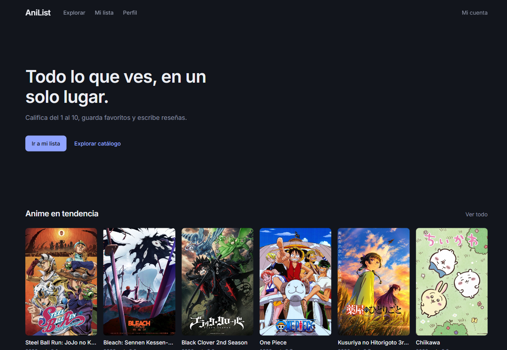
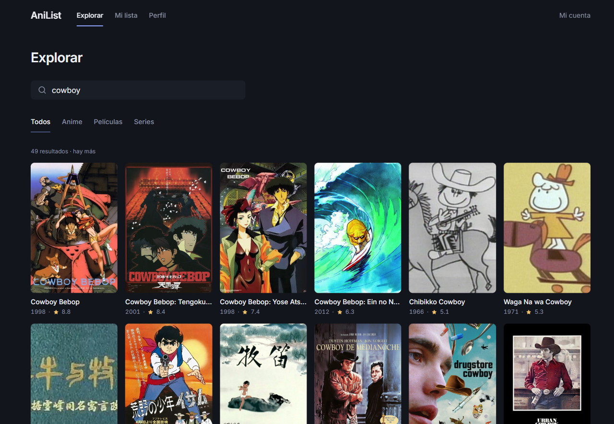
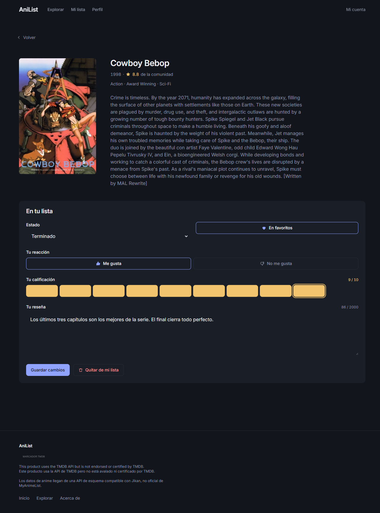
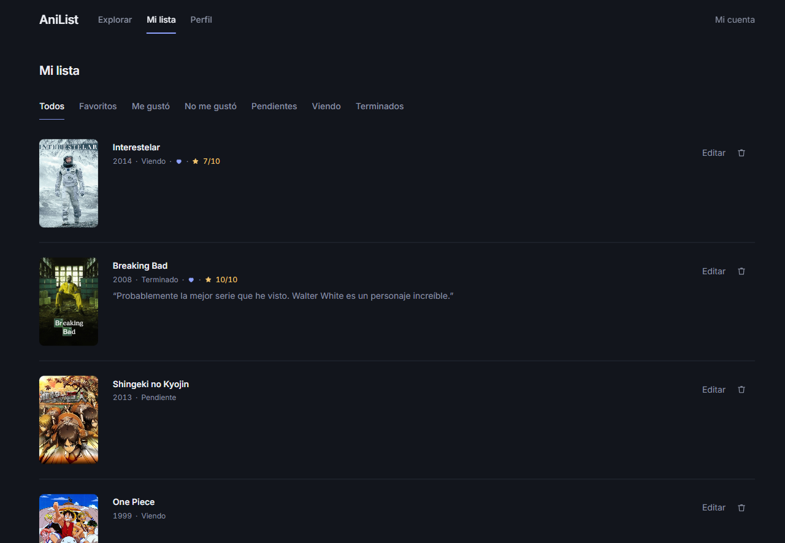
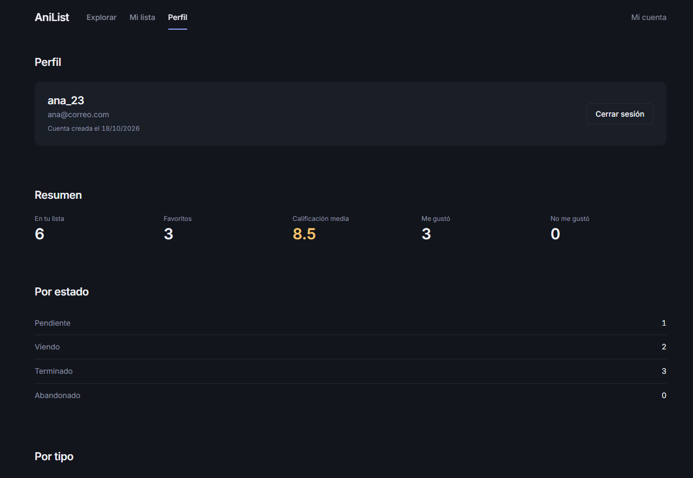
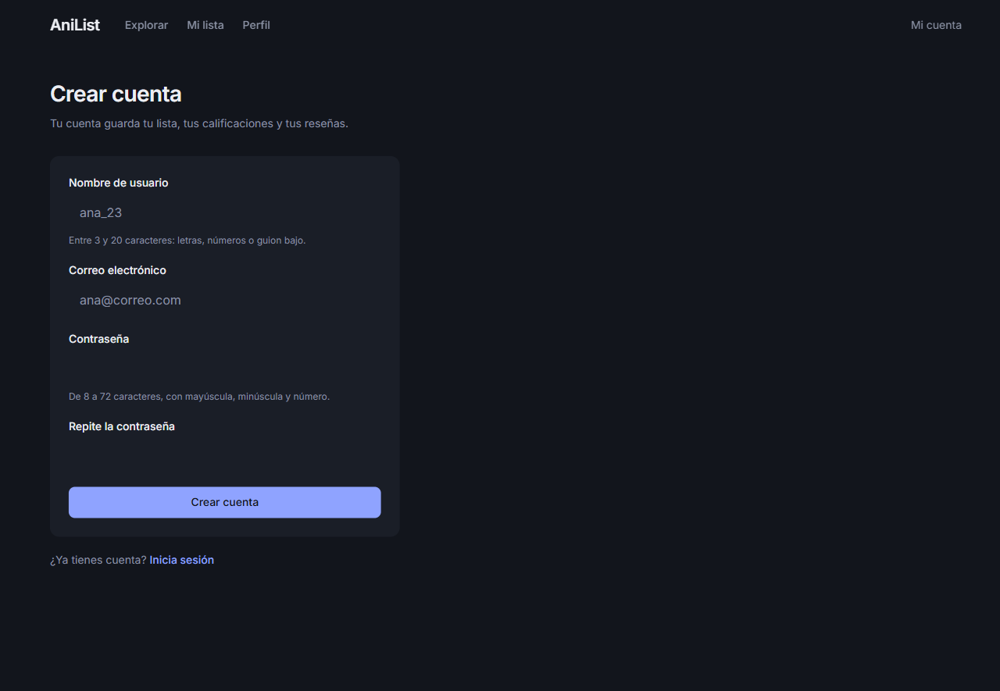
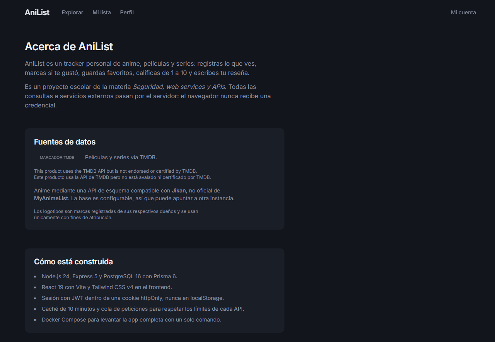

# AniList — IMDb personal de anime, películas y series

Proyecto escolar de la materia **Seguridad, web services y APIs**. Monorepo con un backend
Express 5 + Prisma 6 + PostgreSQL 16 y un frontend React 19 + Vite + Tailwind CSS v4.

- Toda llamada a **TMDB** y **Jikan** sale del backend: el navegador nunca ve las credenciales.
- La sesión vive en un JWT dentro de una cookie `httpOnly` (nunca en `localStorage`).
- Los secretos viven solo en `.env`, que **no** se sube a Git ni entra en la imagen Docker.

## Capturas

### Inicio



Encabezado con el mensaje y dos salidas (crear cuenta / iniciar sesión), seguido de las tres
filas de tendencias: anime, películas y series. Cada fila carga por su cuenta: si una fuente falla,
las otras dos siguen mostrándose.

### Explorar



Buscador con las pestañas **Todos / Anime / Películas / Series**. Cada resultado es un póster con
su año y la puntuación de la comunidad.

### Detalle de un título



Datos del título y el formulario para guardarlo: estado, favorito, reacción, calificación de 1 a
10 y reseña. Si el título ya está en la lista, el formulario aparece lleno para editarlo.

### Mi lista



Todo lo guardado, con filtros (favoritos, me gustó, pendientes, viendo, terminados). "Editar"
abre el mismo formulario en línea, sin salir de la lista.

### Perfil



Totales del usuario: cuántos títulos tiene, cuántos favoritos, su calificación media y sus
reacciones, desglosados por estado y por tipo.

### Crear cuenta



Alta de usuario. Cada campo explica debajo qué formato espera.

### Acerca de



Qué es la aplicación, de dónde salen los datos y con qué está construida.

## Estructura

```
anilist/
├── client/        # React + Vite + Tailwind v4 (dev en :5173)
├── server/        # Express 5 + Prisma 6 (API en :3000)
│   ├── prisma/    # schema.prisma + migraciones
│   ├── src/
│   │   ├── config/env.js         # validación de entorno con Zod
│   │   ├── lib/                  # prisma, errors, cache, httpClient, requestQueue, jwt
│   │   ├── middleware/           # requireAuth, optionalAuth, originCheck, validate, rateLimiters, errorHandler
│   │   └── modules/              # auth, catalog (TMDB + Jikan), list
│   └── tests/     # Vitest + Supertest
├── Dockerfile
├── docker-compose.yml
├── docs/          # capturas de la app + reporte en Word
├── .env.example   # plantilla de configuración
└── .env           # tu configuración local (NO versionada)
```

## Requisitos

- Node.js 24 LTS (no usar Node 20: llegó a fin de vida el 30-abr-2026).
- Docker Desktop, para la opción con Docker.
- Una cuenta en [TMDB](https://www.themoviedb.org/) con un *API Read Access Token*
  (perfil → Settings → API). El anime llega por una API compatible con Jikan que no necesita key,
  así que funciona sin token (ver `JIKAN_BASE_URL` más abajo).

## Preparación (una sola vez)

```bash
git clone <url-del-repo> anilist
cd anilist

npm --prefix server install
npm --prefix client install

cp .env.example .env      # Windows (PowerShell): copy .env.example .env
```

Edita `.env` y coloca:

1. Un `JWT_SECRET` aleatorio de al menos 32 caracteres:

   ```bash
   node -e "console.log(require('crypto').randomBytes(48).toString('hex'))"
   ```

2. Tu `TMDB_API_KEY` con el *API Read Access Token* de TMDB.

3. Una contraseña de PostgreSQL **sin caracteres especiales** (o codifícala en la URL).

4. `CLIENT_ORIGIN`: `http://localhost:5173` si vas a desarrollo con Vite, o
   `http://localhost:3000` si vas a levantar todo con Docker.

## Opción A: Desarrollo (dos procesos, recarga en caliente)

```bash
docker compose up -d db                      # PostgreSQL en localhost:5432
npm --prefix server run prisma:migrate:dev   # crea y aplica la migración
npm --prefix server run dev                  # API en http://localhost:3000
npm --prefix client run dev                  # app en http://localhost:5173
```

Abre **http://localhost:5173**. Vite hace proxy de `/api` hacia `http://localhost:3000` sin tocar
el header `Origin` (lo necesita el control CSRF). `strictPort` está activado: si el 5173 está
ocupado, Vite falla en vez de cambiar de puerto.

## Opción B: Todo con Docker (un solo origen)

En `.env` para el despliegue local por HTTP pon:

```dotenv
CLIENT_ORIGIN=http://localhost:3000
COOKIE_SECURE=false
```

Y ejecuta:

```bash
docker compose up --build
```

Aplica las migraciones (`prisma migrate deploy`) y arranca el servidor, que sirve la API **y** el
build del frontend en **http://localhost:3000**. La imagen final corre como usuario no root.

Prueba limpia desde cero:

```bash
docker compose down -v && docker compose up --build
```

Ojo: el volumen de Postgres guarda la contraseña con la que se inicializó. Si cambias
`POSTGRES_PASSWORD` en `.env` sobre un volumen que ya existe, la app no podrá conectarse: borra
el volumen con `docker compose down -v` antes de volver a levantar.

## Variables de entorno

| Variable | Obligatoria | Descripción |
|---|---|---|
| `NODE_ENV` | no (`development`) | `development`, `test` o `production`. |
| `PORT` | no (`3000`) | Puerto de la API. |
| `CLIENT_ORIGIN` | sí | Origen permitido para CORS y CSRF. |
| `JWT_SECRET` | sí | Mínimo 32 caracteres; se valida al arrancar. |
| `JWT_EXPIRES_IN` | no (`7d`) | Vigencia del token y de la cookie. |
| `DATABASE_URL` | sí | Cadena de conexión a PostgreSQL. |
| `TMDB_API_KEY` | sí | *API Read Access Token* de TMDB (va como `Bearer`). |
| `JIKAN_BASE_URL` | no (`https://api.tenrai.org/v1`) | Base de la API de anime. Cámbiala a una instancia propia si la actual no te sirve. |
| `COOKIE_SECURE` | no | Fuerza `Secure` en la cookie; por defecto es `true` en producción. |
| `POSTGRES_USER` / `POSTGRES_PASSWORD` / `POSTGRES_DB` | sí (Docker) | Credenciales del PostgreSQL del compose. |

Si falta o es inválida alguna, el servidor **se niega a arrancar**:

```
[env] Configuración inválida. Revisa tu archivo .env (copia .env.example):
  - JWT_SECRET: JWT_SECRET debe tener al menos 32 caracteres
```

## Endpoints

| Método | Ruta | Auth | Descripción |
|---|---|---|---|
| GET | `/api/health` | No | `{ status: "ok" }` (healthcheck de Docker). |
| POST | `/api/auth/register` | No | Registro. 409 si el correo o el usuario ya existen. |
| POST | `/api/auth/login` | No | Login. 401 con mensaje genérico. |
| POST | `/api/auth/logout` | No | Idempotente, borra la cookie. |
| GET | `/api/auth/me` | Sí | Usuario de la sesión (consulta la BD en cada llamada). |
| GET | `/api/catalog/search` | No | `q`, `type` (`ALL\|MOVIE\|SERIES\|ANIME`), `page`. |
| GET | `/api/catalog/trending` | No | `type` (`MOVIE\|SERIES\|ANIME`, por defecto `ANIME`). |
| GET | `/api/catalog/:source/:externalId` | Opcional | Detalle + `myEntry`. |
| GET | `/api/me/list` | Sí | Filtros `status`, `reaction`, `favorite`, `type`, `page`, `limit`. |
| POST | `/api/me/list` | Sí | Agrega un título (el snapshot se arma en el servidor). |
| PATCH | `/api/me/list/:id` | Sí | Actualiza estado, reacción, favorito, calificación o reseña. |
| DELETE | `/api/me/list/:id` | Sí | 204. |
| GET | `/api/me/stats` | Sí | Totales por estado y tipo, favoritos, reacciones y media. |

Formato de error estándar: `{ error: { code, message, fieldErrors? } }`.

## Pruebas

```bash
npm --prefix server test
```

Vitest + Supertest importan `app.js` sin abrir puertos. Los proveedores externos se prueban con
`fetch` simulado y fixtures: **las pruebas nunca llaman a TMDB ni a Jikan reales**.

Cobertura actual (**144 tests, 7 archivos, todos en verde**):

| Archivo | Qué cubre |
|---|---|
| `tests/auth.test.js` | Registro, 409 por email y por username, login con email inexistente y con contraseña incorrecta (respuestas idénticas), cookie `httpOnly`/`SameSite=Lax` sin `Secure` en test, ningún body con `passwordHash`, `me` con y sin sesión, JWT manipulado/expirado/`alg: none`, `Origin` ausente o ajeno → 403, 11.º intento → 429 y otra IP con su propio cupo. |
| `tests/catalog-normalizers.test.js` | El formato común de las tres fuentes con fixtures: año, score con un decimal, póster de TMDB con su prefijo, `genres` vacío en listados, sinopsis vacía → `null`. |
| `tests/catalog.test.js` | Búsqueda por tipo y `ALL` con una fuente caída, `hasMore`, trending, detalle, caché (una sola llamada externa), 429 reintentado, 5xx persistente → 502 sin filtrar el texto del proveedor, 404 externo, y que ni la cabecera `Bearer` ni el token aparezcan en respuestas ni en logs. |
| `tests/catalog-timeout.test.js` | El timeout de 8 s con reloj falso. |
| `tests/request-queue.test.js` | Espaciado de 400 ms entre llamadas a Jikan medido a través de la API, orden, ventana deslizante y peticiones en vuelo compartidas. |
| `tests/circuit-breaker.test.js` | Corta-circuito por proveedor: se abre tras varios fallos seguidos, se cierra con un éxito, deja pasar un sondeo al vencer el enfriamiento y responde 502 sin llamar a `fetch`. |
| `tests/list.test.js` | CRUD, aislamiento entre usuarios (siempre 404), duplicado → 409, `rating` 0 y 11 → 400, campo desconocido → 400, `favorite=false`, paginación, stats, `myEntry`, snapshot construido por el servidor, refresco a los 30 días y que `fetchedAt` nunca llegue al cliente. |

Estado de auditoría:

- `npm audit --omit=dev` en `server`: **0 vulnerabilidades**.
- `npm audit` en `client`: **0 vulnerabilidades**.
- Riesgo residual conocido: `vitest` y `tinypool` (solo `devDependencies`, no se despliegan)
  tienen avisos de seguridad que se corrigen con un salto de versión mayor de Vitest. La app en
  producción no depende de ellos.

## Atribución de TMDB

Este producto usa la API de TMDB. El aviso oficial
("This product uses the TMDB API but is not endorsed or certified by TMDB.") aparece en el pie de
todas las páginas y en `/acerca`. Los datos de anime llegan por una API de esquema **Jikan**
(no oficial de MyAnimeList). La API pública de Jikan (`api.jikan.moe/v4`) fue **descontinuada el
1-oct-2026** ([jikan-rest#613](https://github.com/jikan-me/jikan-rest/issues/613)); por eso el
proyecto apunta por defecto a [Tenrai](https://api.tenrai.org/v1), cuyo esquema es compatible con
Jikan v4, y la base es configurable con `JIKAN_BASE_URL`.

> **Pendiente:** `client/src/assets/tmdb-logo.svg` es un marcador. Descarga el logo oficial de
> https://www.themoviedb.org/about/logos-attribution y reemplaza el archivo. No lo deformes ni lo
> recolorees, y déjalo más pequeño que el nombre de la app.

## Seguridad

| Control | Dónde está | Cómo probarlo |
|---|---|---|
| Contraseñas con hash | `modules/auth/service.js` (bcrypt coste 12) | `grep -r passwordHash server/src` |
| `passwordHash` nunca en respuestas | `select` explícito en `auth/service.js` | `curl -i -X POST localhost:3000/api/auth/register ... \| grep -c passwordHash` → 0 |
| Login sin fuga de información | `auth/service.js` compara contra `DUMMY_HASH` si el email no existe | Login con email inexistente y con contraseña mala: mismo 401 y mismo cuerpo |
| Cookie `httpOnly` + `SameSite=Lax` | `modules/auth/controller.js` | `curl -i -c - -X POST localhost:3000/api/auth/register -H "Origin: $CLIENT_ORIGIN" ... \| grep Set-Cookie` |
| `Secure` solo en producción | `config/env.js` (`cookieSecure`) | Con `COOKIE_SECURE=false` la cookie no lleva `Secure`; en producción sí |
| JWT HS256 verificado con algoritmo fijo | `lib/jwt.js` (`algorithms: ["HS256"]`) | Token con `alg: none` o firma alterada → 401 en `/api/auth/me` |
| Sesión revocable (usuario borrado) | `middleware/requireAuth.js` consulta la BD en cada petición | Borra el usuario en la BD y `/api/auth/me` responde 401 |
| CSRF en dos capas | cookie `SameSite=Lax` + `middleware/originCheck.js` en POST/PATCH/DELETE | `curl -X POST .../api/auth/login` sin `Origin` → 403 `FORBIDDEN_ORIGIN` |
| Validación estricta de la entrada | `middleware/validate.js` + esquemas `.strict()` | `curl .../api/me/list -X POST -d '{"status":"COMPLETED","hack":1}'` → 400 |
| Sin SQL crudo | Prisma en todas las consultas (el único SQL a mano es el CHECK de la migración) | `grep -rn "prisma.$queryRaw" server/src` → sin resultados |
| Límite de tamaño del body | `app.js` (`express.json({ limit: "10kb" })`) | Enviar un body enorme → 413 |
| CORS con lista blanca | `app.js` (`origin: env.CLIENT_ORIGIN`, `credentials: true`) | `curl -H "Origin: https://evil.example" -i ...` → sin `Access-Control-Allow-Origin` |
| Rate limiting | `middleware/rateLimiters.js` | 11 intentos de login seguidos → 429 con `{ error: { code: "RATE_LIMITED" } }` |
| Autorización por token | `userId` siempre sale de `req.user.id` | Intentar `PATCH` sobre un id ajeno → 404 |
| No revelar existencia de recursos | `modules/list/service.js` filtra por `{ id, userId }` y responde 404 | Un usuario no puede tocar registros de otro (siempre 404, nunca 403) |
| CSP ajustada | `app.js` (helmet) | `curl -i localhost:3000/api/health \| grep -i content-security-policy` |
| Límites de las APIs externas | `lib/requestQueue.js` (400 ms entre llamadas, 55/min) y reintentos acotados en `lib/httpClient.js` | Tests de cola y reintentos |
| Errores externos no se reenvían | `lib/httpClient.js` responde 502 con `UPSTREAM_ERROR` | Un 500 de TMDB → 502 sin el texto del proveedor |
| Snapshots que caducan | `modules/list/snapshot.service.js` (refresco a los 30 días) | Un `Title` con `fetchedAt` antiguo se refresca al pedir la lista |
| Secretos fuera de Git y de la imagen | `.gitignore` + `.dockerignore` | `git status` no muestra `.env`; `docker compose exec app ls /app` no lo encuentra |
| Contenedor sin root | `Dockerfile` (`USER node`) | `docker compose exec app id` → `uid=1000(node)` |
| Base de datos no expuesta | `docker-compose.yml` publica solo `127.0.0.1:5432` | `docker compose port db 5432` → `127.0.0.1:5432` |

### Limitaciones conocidas

- **Un JWT robado sigue siendo válido hasta expirar (7 días).** El logout solo borra la cookie. Una
  mejora natural es una lista de revocación (blocklist) de tokens o sesiones muy cortas con
  refresco.
- **Detrás de un proxy inverso hay que configurar `trust proxy`.** La app lo tiene en `1`; si hay
  más de un proxy, ajústalo, porque los limitadores de peticiones usan la IP y una IP mal
  detectada hace que el límite se aplique a todos los usuarios a la vez.
- **`upgradeInsecureRequests` está desactivado** en la CSP porque el despliegue es `http://`. Con
  HTTPS real, vuelve a activarlo.
- **`deepmerge-ts`** (dependencia transitiva de la CLI de Prisma) está fijada a `^8` con
  `overrides` para eliminar su aviso de seguridad sin degradar Prisma.
- **El logo de TMDB sigue siendo un marcador** hasta que descargues el oficial.

## Decisiones de diseño

Tema oscuro con **un solo acento**. Los colores están declarados como tokens CSS en
`client/src/index.css` y ninguno más se usa en los componentes:

| Token | Valor | Para qué |
|---|---|---|
| `--bg` | `#12151C` | Fondo de la aplicación |
| `--surface` | `#1A1E27` | Paneles, tarjetas de formulario e inputs |
| `--line` | `#262B36` | Bordes, solo cuando separan algo |
| `--text` | `#ECEEF3` | Texto principal |
| `--muted` | `#8A91A3` | Texto secundario y metadatos |
| `--accent` | `#8FA3FF` | Botones, enlaces y estado activo |
| `--rating` | `#F2C46D` | **Solo** la estrella y la nota |
| `--danger` | `#FF8F8F` | Solo errores y acciones destructivas |

Todas las combinaciones texto/fondo superan el contraste AA.

- **Tipografía**: Inter (400 / 500 / 600) con `system-ui` de respaldo, y una escala fija de
  12 / 14 / 16 / 20 / 28 / 44 px. Títulos con `letter-spacing: -0.02em` y `line-height: 1.15`;
  cuerpo a 1.5 y con un máximo de ~65 caracteres por línea (`.measure`).
- **Los números usan cifras de ancho fijo** (`tabular-nums`) para que las notas y los años no
  bailen al cambiar de valor.
- **Sin sombras, sin degradados y sin cajas de más.** La jerarquía sale del espacio, del tamaño
  del texto y del peso. La tarjeta de un título es solo el póster (relación 2:3, radio 8px) más
  el título y una línea de metadatos; no lleva borde ni fondo.
- **Un solo radio**: 8px en posters y botones, 12px en paneles grandes.
- **Movimiento**: transiciones de 150 ms solo en hover, foco y apertura de paneles, y todo se
  anula con `prefers-reduced-motion`.
- **Accesibilidad**: foco visible siempre, áreas táctiles de 44px y barra inferior de navegación
  en móvil.

El token más distintivo sigue siendo la calificación de 1 a 10 dibujada como diez barras: se lee
de un vistazo y es más precisa que cinco estrellas.

> **Nota sobre Google Fonts:** la CSP ahora permite `https://fonts.googleapis.com` en `style-src` y
> `https://fonts.gstatic.com` en `font-src`, que es lo único que se añadió. Si prefieres no
> depender de un tercero, descarga el `.woff2` de Inter, sírvelo desde el propio cliente y
> devuelve `style-src` a `'self'`.

## Estructura de la API y resiliencia

- **Caché LRU** de 10 minutos y 500 entradas, solo con datos externos; `myEntry` se agrega
  después de leer la caché, nunca se cachea.
- **Peticiones en vuelo compartidas**: dos usuarios que piden el mismo detalle al mismo tiempo
  generan una sola llamada externa.
- **Reintentos** solo para 429, 5xx y errores de red, con backoff exponencial y jitter, respetando
  el `Retry-After` y con timeout de 8 s con `AbortController`.
- **Corta-circuito por proveedor** (`lib/circuitBreaker.js`): tras tres llamadas fallidas seguidas
  el proveedor se marca como caído y las siguientes responden 502 **al instante**, sin gastar los
  ~35 s del peor caso. Se cierra con un solo éxito, es independiente por proveedor (que caiga el
  anime no afecta a las películas) y al vencer el enfriamiento de 60 s deja pasar una llamada de
  sondeo.
- **Búsqueda `type=ALL`**: lanza TMDB película + TMDB serie + Jikan en paralelo con
  `Promise.allSettled`; si una fuente falla se devuelven las otras. Orden: anime, película, serie.
  Cada fuente tiene además un plazo de 10 s: si no responde dentro de él se descarta y no hace
  esperar al usuario por la fuente caída.
- **La cola solo serializa Jikan** (3 req/s y 60 req/min). Las peticiones de TMDB no pasan por el
  mutex: si lo hicieran, una fuente caída con reintentos bloquearía a las demás.